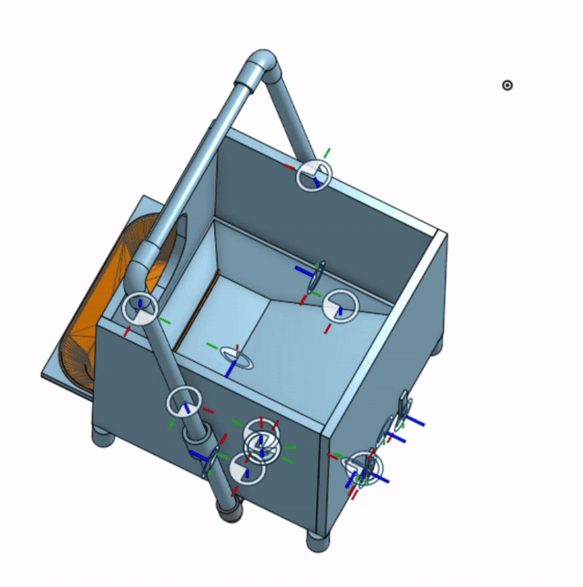
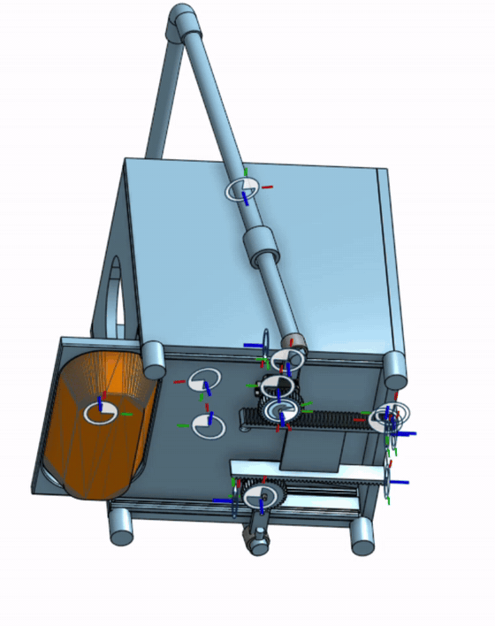

# Automatic Cat Feeder

CAD model and motion animations for an automatic cat feeding machine.

A physical prototype has been built. The animations below show the CAD mechanism.

## Assembly animation

## Underside mechanism

## Project files

| File | Description |
| --- | --- |
| [CAD model (STL)](cad/automatic-cat-feeder.stl) | Original exported 3D model |
| [Assembly animation (MP4)](assets/assembly-animation.mp4) | Original animation recording |
| [Underside animation (MP4)](assets/underside-animation.mp4) | Original animation recording of the underside |

The looping images above are CAD motion previews. The original model and MP4 recordings are included for download.
